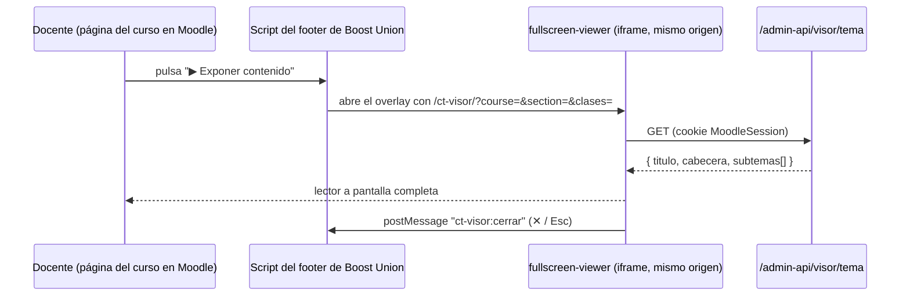

<div align="center">

# ConectaTech Fullscreen Viewer

**Un lector a pantalla completa para un tema de curso: índice colapsible de subtemas, panel de contenido con scroll y navegación anterior/siguiente, con el mismo aspecto del curso de Moodle desde el que se abrió.**

[](https://conectatech.co)
[](../LICENSE)
[](https://angular.dev)
[](https://www.typescriptlang.org)
[](https://moodle.org)
[](https://nasa-ammos.github.io/slim/?search=Badges)
[](https://nasa-ammos.github.io/slim/)
[](./README.md)

</div>

---

## Qué es

Los docentes proyectan el contenido del curso en clase. La página de curso de Moodle está pensada para estudiar, no para exponer: los cajones laterales, la barra superior y las secciones largas estorban. Esta app muestra **un tema a la vez, a pantalla completa**, solo con el contenido expositivo (los labels «Área de texto y medios»). Las evaluaciones y los presaberes se quedan en Moodle.

- **Índice + panel.** Un índice lateral colapsible lista los subtemas; el panel central muestra el elegido. Ambos tienen scroll propio.
- Botones **Anterior / Siguiente**, y también las teclas ← →. `Esc` cierra el visor.
- **Estilos del curso heredados.** Los banners de referente bíblico, los colores por área y la tipografía coinciden con el curso porque el visor compila el mismo SCSS que se pega en el tema Boost Union de Moodle.
- **Solo docentes y gestores.** El botón *▶ Exponer contenido* es un label oculto de Moodle y la API valida el permiso en el servidor.

Decisiones de diseño: [ADR-012](../MEMORY.md) y [`docs/visualizador-fullscreen.md`](../docs/visualizador-fullscreen.md).

---

## Cómo funciona



El visor se sirve desde el **mismo origen que Moodle**, así que comparte la cookie de sesión y no necesita CORS ni tokens. La API (`admin-module/api/handlers/visor.php`) lee en vivo los labels de la sección, de modo que el visor siempre refleja lo que el docente ve en el curso.

### Parámetros de la URL

| Parámetro | Significado |
|---|---|
| `course` | ID del curso en Moodle (entero positivo) |
| `section` | ID de la sección del tema en Moodle (entero positivo) |
| `clases` | Clases del `<body>` separadas por espacio o `+` (`cosmovision-cristiana`, `ciencias-naturales`, `grado-6`…) para que se aplique el SCSS del curso. Cada una debe cumplir `^[a-z0-9-]{1,40}$`; máximo 12 |
| `demo=1` | Carga `demo/tema.json` (solo en builds de desarrollo) |

Todo lo que llega por la URL se valida en [`src/app/parametros.ts`](src/app/parametros.ts).

---

## Desarrollo

Requiere Node.js 22+ (desarrollado con 24).

```bash
npm install
npm start              # ng serve en http://localhost:4200
npm test               # pruebas unitarias (Vitest)
npm run build          # build de producción en dist/fullscreen-viewer/browser/
```

Datos de demostración (texto sintético, sin contenido real de cursos):

```
http://localhost:4200/?demo=1&clases=cosmovision-cristiana+ciencias-naturales+grado-6
```

El endpoint real necesita una sesión de Moodle, así que solo funciona una vez desplegado bajo `conectatech.co`.

### Estilos

`src/styles.scss` importa `../../snippets/conectatech-pre.scss` y `conectatech-post.scss` **directamente**: no se copia nada. Consecuencias:

- Cuando cambie un snippet, hay que recompilar y redesplegar este visor para que no se desincronice de Moodle.
- No se carga Bootstrap. `post.scss` hace `@extend .btn-primary`, así que `styles.scss` declara un `.btn-primary` vacío para satisfacerlo y añade los estilos base mínimos que normalmente aporta Boost.

El bundle de producción pesa ~212 kB (~60 kB transferidos).

---

## Despliegue

El visor vive en `/var/www/html/ct-visor/` en el servidor EC2 — **fuera** de `/var/www/html/admin/`, para que el `rsync --delete` del panel admin no pueda borrarlo — y se expone con `Alias /ct-visor /var/www/html/ct-visor` en `/etc/httpd/conf.d/moodle-le-ssl.conf`.

```bash
npm audit && npm run build        # en primer plano; nunca en paralelo con el rsync

command ssh -i ~/.ssh/ClaveCT.pem ec2-user@54.86.113.27 \
  "sudo chown -R ec2-user:ec2-user /var/www/html/ct-visor"
rsync -e "command ssh -i ~/.ssh/ClaveCT.pem" -a --delete \
  dist/fullscreen-viewer/browser/ ec2-user@54.86.113.27:/var/www/html/ct-visor/
command ssh -i ~/.ssh/ClaveCT.pem ec2-user@54.86.113.27 \
  "sudo chown -R apache:apache /var/www/html/ct-visor"
```

El procedimiento completo, con las piezas del lado del servidor, está en [`tech-specs.md` §6.4 y §7.2](../tech-specs.md).

---

## Seguridad

- El visor no guarda secretos y hace una única petición `GET` de solo lectura.
- La autorización se aplica en el servidor (`auth.php`, `moodle/course:viewhiddenactivities`); ocultar el botón a los estudiantes es UX, no el control.
- El HTML del contenido se enlaza con `[innerHTML]` y el sanitizador por defecto de Angular — nunca `bypassSecurityTrust*`. Las pruebas cubren la eliminación de `script` y `onerror`.
- Los errores del servidor se traducen a mensajes fijos en español; nunca se muestra el cuerpo de la respuesta.

---

## Estructura del proyecto

```
fullscreen-viewer/
├── demo/tema.json          # datos sintéticos, solo en los builds de desarrollo
├── public/                 # favicon
└── src/
    ├── styles.scss         # importa snippets/ (estilos del curso) + estilos base
    └── app/
        ├── app.*           # shell: barra superior, estado, teclado, cierre
        ├── indice.*        # índice colapsible de subtemas
        ├── panel.*         # panel de contenido + barra anterior/siguiente
        ├── tema.ts         # contrato de la respuesta, validación, mensajes de error, recurso de datos
        └── parametros.ts   # lectura y validación de los parámetros de la URL
```

---

## Licencia

Propietaria — © ConectaTech - Oliver Castelblanco. Ver [LICENSE](../LICENSE).
