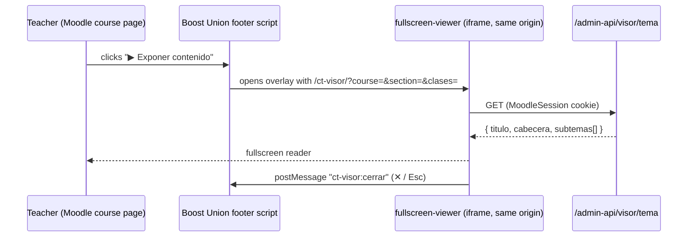

<div align="center">

# ConectaTech Fullscreen Viewer

**A fullscreen reader for one course topic: a collapsible index of subtopics, a scrolling content panel and previous/next navigation, styled exactly like the Moodle course it was opened from.**

[](https://conectatech.co)
[](../LICENSE)
[](https://angular.dev)
[](https://www.typescriptlang.org)
[](https://moodle.org)
[](https://nasa-ammos.github.io/slim/?search=Badges)
[](https://nasa-ammos.github.io/slim/)
[](./README.es.md)

</div>

---

## What It Is

Teachers project course content in class. Moodle's course page is built for studying, not for presenting: drawers, navbars and long scrolling sections get in the way. This app shows **one topic at a time, fullscreen**, using only the expository content (the *Text and media area* labels). Quizzes and *presaberes* stay in Moodle.

- **Index + panel layout.** A collapsible side index lists the subtopics; the center panel shows the selected one. Both scroll independently.
- **Previous / next** buttons, plus the ← → keys. `Esc` closes the viewer.
- **Course styling inherited.** The bible-reference banners, section colors and typography match the course because the viewer compiles the same SCSS that is pasted into Moodle's Boost Union theme.
- **Teachers and managers only.** The *▶ Exponer contenido* button is a hidden Moodle label, and the API checks the permission on the server.

Design decisions and trade-offs: [ADR-012](../MEMORY.md) and [`docs/visualizador-fullscreen.md`](../docs/visualizador-fullscreen.md).

---

## How It Works



The viewer is served from the **same origin as Moodle**, so it shares the session cookie and needs no CORS or tokens. The API (`admin-module/api/handlers/visor.php`) reads the section's labels live from Moodle, so the viewer always reflects what teachers see in the course.

### URL parameters

| Parameter | Meaning |
|---|---|
| `course` | Moodle course id (positive integer) |
| `section` | Moodle section id of the topic (positive integer) |
| `clases` | Space- or `+`-separated body classes (`cosmovision-cristiana`, `ciencias-naturales`, `grado-6`…) so the course SCSS applies. Each must match `^[a-z0-9-]{1,40}$`; at most 12 |
| `demo=1` | Loads `demo/tema.json` (development builds only) |

Everything that arrives through the URL is validated in [`src/app/parametros.ts`](src/app/parametros.ts).

---

## Development

Requires Node.js 22+ (developed on 24).

```bash
npm install
npm start              # ng serve on http://localhost:4200
npm test               # unit tests (Vitest)
npm run build          # production build into dist/fullscreen-viewer/browser/
```

Open the demo data (synthetic text, no real course content):

```
http://localhost:4200/?demo=1&clases=cosmovision-cristiana+ciencias-naturales+grado-6
```

The real endpoint needs a Moodle session, so it only works once deployed under `conectatech.co`.

### Styles

`src/styles.scss` imports `../../snippets/conectatech-pre.scss` and `conectatech-post.scss` **directly** — nothing is copied. Two consequences:

- When a snippet changes, rebuild and redeploy this viewer so it doesn't drift from Moodle.
- Bootstrap is not loaded. `post.scss` does `@extend .btn-primary`, so `styles.scss` declares an empty `.btn-primary` to satisfy it, and adds the minimal base styles Boost would normally provide.

The production bundle is ~212 kB (~60 kB transferred).

---

## Deployment

The viewer lives in `/var/www/html/ct-visor/` on the EC2 server — **outside** `/var/www/html/admin/`, so the admin panel's `rsync --delete` can't remove it — exposed with `Alias /ct-visor /var/www/html/ct-visor` in `/etc/httpd/conf.d/moodle-le-ssl.conf`.

```bash
npm audit && npm run build        # run in the foreground; never in parallel with rsync

command ssh -i ~/.ssh/ClaveCT.pem ec2-user@54.86.113.27 \
  "sudo chown -R ec2-user:ec2-user /var/www/html/ct-visor"
rsync -e "command ssh -i ~/.ssh/ClaveCT.pem" -a --delete \
  dist/fullscreen-viewer/browser/ ec2-user@54.86.113.27:/var/www/html/ct-visor/
command ssh -i ~/.ssh/ClaveCT.pem ec2-user@54.86.113.27 \
  "sudo chown -R apache:apache /var/www/html/ct-visor"
```

The full procedure, including the server-side pieces, is in [`tech-specs.md` §6.4 and §7.2](../tech-specs.md).

---

## Security

- The viewer holds no secrets and makes one read-only `GET`.
- Authorization is enforced server-side (`auth.php`, `moodle/course:viewhiddenactivities`); the button being hidden from students is UX, not the control.
- Content HTML is bound with `[innerHTML]` and Angular's default sanitizer — never `bypassSecurityTrust*`. Tests cover script and `onerror` removal.
- Server errors are mapped to fixed Spanish messages; response bodies are never rendered.

---

## Project Structure

```
fullscreen-viewer/
├── demo/tema.json          # synthetic data, bundled into development builds only
├── public/                 # favicon
└── src/
    ├── styles.scss         # imports snippets/ (course styling) + base styles
    └── app/
        ├── app.*           # shell: top bar, state, keyboard, close handshake
        ├── indice.*        # collapsible subtopic index
        ├── panel.*         # content panel + previous/next bar
        ├── tema.ts         # response contract, validation, error messages, data resource
        └── parametros.ts   # URL parameter parsing and validation
```

---

## License

Proprietary — © ConectaTech - Oliver Castelblanco. See [LICENSE](../LICENSE).
